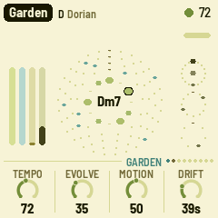

# AURA-1 for the M-VAVE FM-1

AURA-1 turns the M-VAVE FM-1 into a generative ambient machine, inspired by Brian Eno's
*Music for Airports*. It plays itself from the moment it's switched on: breathing voices, soft
bells on tape loops of unequal length, a gliding bass and quiet Euclidean percussion, all through
a tape echo, a long tape loop and a plate reverb. You don't perform it, you tend it: pick a piece
and a scale, take notes out, put them back, and let it grow.

AURA-1 is a modified copy of Charles Vestal's AMB-1. It adds **Solo Mode** for live polyphonic
playing and **Random World**, a preset randomizer that generates new ambient patches.
[Original AMB-1 repository](https://github.com/charlesvestal/fm1-amb)

  

- **Try it in your browser** (no FM-1 needed): [Web Emulator](https://ahaku.github.io/AURA-1/emu/)
- **Install it** (Chrome or Edge, with the FM-1 plugged in): [Web Installer](https://ahaku.github.io/AURA-1/install/)
- **Read the manual**: [Interactive Manual](docs/MANUAL.md)
- **Download a release**: [Firmware releases](https://github.com/ahaku/AURA-1/releases)
- **Bundled firmware** (0.0.3): [Firmware package](firmware/aura-1.fwsc)

The website follows `main` and offers the latest development build. Tagged, verified
versions are available under Releases. The [illustrated web guide](https://ahaku.github.io/AURA-1/manual/)
is also available on GitHub Pages.

Installing it is at your own risk, though it's hard to get stuck: the web installer can put
M-VAVE's own firmware back, and an FM-1 that fails to start twice comes up in a safe mode the
installer can reach.

## In short

| | |
|---|---|
| Keys | The scale: each key adds its note or takes it out |
| PLAY · REC · EDIT | Grow / rest · freeze · the next chord (hold EDIT: random world) |
| SEL | Solo mode: keys play live polyphonic synth over the garden; 6 pages (Preset, ADSR, Tone, Delay, Reverb, Arp) on KNOB 1–4 |
| HOME · ENV · ARP · LFO · SEQ · FX · GLO | The pages: Garden (Motion, Texture), Pad, Bells, Bass & Bowls, Pulse, Space, Setup; KNOB 1–4 set their values, a layer's level on KNOB 1 |
| SELECT | The previous or next page; with HOME held, the tempo |
| ALGORITHM · PRESETS | The mode · the piece (sixteen of them) |
| OCT− / OCT+ | The bells' octave |
| SAVE | Saves all 16 pieces (in Solo: saves to User preset); held, puts back to recipe |

Hold any button for a second and a card says what it does.

AURA-1 also tells the [FM-1 Screen Reader](https://charlesvestal.github.io/fm1-reader/) what its screen
shows, over USB: the page and its knobs, a knob's value as it turns, the piece, the chord as it moves,
and what each button did.

The [manual](docs/MANUAL.md) has the rest.

## Building and testing

AURA-1 is an app on [fm1-base](https://github.com/charlesvestal/fm1-base) (`base/`, a git submodule); clone with
`--recursive`. The toolchain and prerequisites are in [BUILDING.md](BUILDING.md):

```
sh tests/run_tests.sh                                  # the instrument, the app in a simulator, the web builds
./build.sh                                             # app/build/aura-1.fwsc
python3 base/tools/fm1_install.py app/build/aura-1.fwsc   # install it over USB
```

`app/build/host/aura-1_host SCRIPT OUTDIR` runs the whole app on a computer from a script
(`tests/scenarios/*.amb`), with audio and screenshots coming out. `./build.sh --web` builds the same code for the
browser (the emulator); `web/app/build.sh` builds the engine alone into a web app for phone and desktop.

## Credits

The idea comes from Brian Eno's generative music: *Music for Airports*' tape loops of unequal
length, and the echo chain of *Discreet Music*. The reverb is Jon Dattorro's plate ("Effect Design,
Part 1", JAES 1997), as in [FoMni-1](https://github.com/charlesvestal/fm1-fomni); the Euclidean
rhythms are Godfried Toussaint's reading of Bjorklund's algorithm. AURA-1 is built on
[fm1-base](https://github.com/charlesvestal/fm1-base) and [felucca-bsp](https://github.com/hugelton/felucca-bsp),
from [Felucca](https://github.com/hugelton/Felucca) by Leo Kuroshita (Hügelton Instruments). The idea of running
FM-1 firmware in the browser comes from [Groove OS](https://www.groove-os.com/). MPL-2.0 (0.9 and earlier:
GPL-3.0-only); see [LICENSING.md](LICENSING.md).

M-VAVE and FM-1 are trademarks of their owners. AURA-1 is not affiliated with M-VAVE, Brian Eno or
Hügelton Instruments.
