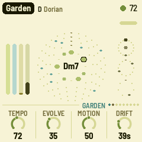

# AURA-1

AURA-1 turns the M-VAVE FM-1 into an enhanced generative ambient synthesizer, built on top of Charles Vestal's open-source [fm1-amb](https://github.com/charlesvestal/fm1-amb) firmware and inspired by Brian Eno's
*Music for Airports*. It plays itself from the moment it's switched on: breathing voices, soft
bells on tape loops of unequal length, a gliding bass and quiet Euclidean percussion, all through
a short echo, a long tape loop and a plate reverb. You don't perform it, you tend it: pick a piece
and a scale, take notes out, put them back, and let it grow.

, running AURA-1, each control labelled")

---

## Contents

1. Install
2. Getting started
3. Controls
4. The screen
5. The garden
6. The pieces
7. The pages
8. MIDI
9. Saving
10. Troubleshooting
11. Parameters
12. Credits & License

---

## 1. Install

**Try it first:** the [AURA-1 emulator](../emu/) runs the same
code in the browser, with sound, played with the mouse, a touch screen or the keyboard.

**Install:** open the [web installer](../install/) in Chrome or
Edge, connect the FM-1 with a USB data cable and press Install. Don't unplug it while it's
writing; when it finishes, the FM-1 restarts into AURA-1.

To go back to M-VAVE's firmware, use "Back to the stock firmware" at the bottom of the same page.
Download the FM-1 V15 file from the link there, choose it and press the button. M-VAVE's own
updater, M-UPGRADE, works too.

> Installing other firmware is at your own risk. If the FM-1 ever won't start, see
> [Recovering an FM-1 that won't start](#recovering-an-fm-1-that-won-t-start).

<details><summary>Install from the command line</summary>

Download the firmware file (for example `aura-1.0.fwsc`) from the
[releases page](https://github.com/ahaku/AURA-1/releases), get the source from GitHub
(`git clone --recursive https://github.com/ahaku/AURA-1`), install Python 3 with
`pip3 install mido python-rtmidi`, and run:

```
python3 base/tools/fm1_install.py aura-1.0.fwsc
```

</details>

---

## 2. Getting started

AURA-1 starts playing as soon as it's on. A few minutes with it:

1. **Listen.** The first piece, Garden, is playing: D Dorian, pad, bells, bass and a soft pulse.
   Turn MASTER for the volume.
2. **Try another piece.** Turn PRESETS. Each of the sixteen pieces has its own key, tempo, sounds
   and amount of movement.
3. **Change the scale.** Press a key whose note is lit to take that note out of the scale, so
   nothing plays it. Press it again to bring it back. Press a key that isn't lit to add its note.
4. **Move on.** Press EDIT, and the pad moves to the next chord at the start of the next bar.
5. **Freeze.** Press REC to hold the chord and let the reverb ring on forever, while the bells and
   pulse go on above it. Press REC again to let it go.
6. **Shape a layer.** Each layer has its own button: ENV for the pad, ARP for the bells, LFO for
   the bass and SEQ for the pulse. FX opens the space, HOME the garden as a whole, and GLO the
   setup. Turn KNOB 1–4 to set the four values at the bottom of the screen. KNOB 1 is always the
   layer's level. Turn SELECT to step through the pages.
7. **Rest.** Press PLAY, and the garden stops growing while its sounds slowly fade out. Press PLAY
   again and it grows back.

What you change is kept with the piece. AURA-1 saves it by itself while resting, or press SAVE.

To find out what a button does, hold it for a second to see a card. Let go and nothing happens.
PLAY has no help card; holding HOME opens the Cosmic Screensaver, and holding EDIT generates a
Random World.

---

## 3. Controls

The drawing at the top shows every control. Here they are in more detail.

| Control | What it does |
|---|---|
| Keys | The scale. Each key adds its note to the scale or takes it out; the keys light up for the notes in it. Every octave of a note is the same key. The root stays, and the scale keeps at least three notes. |
| PLAY | Grow / rest. AURA-1 starts growing by itself when it's switched on. At rest, the sounds fade out slowly and the reverb rings away. Lit green while growing. |
| REC | **Freeze**: the chord holds and the reverb rings on forever, while the bells and pulse go on dry above it. Press again to thaw. Lit while frozen. |
| EDIT | The next chord, at the start of the next bar (at once while resting). Hold EDIT (0.8s): **Random World** (procedurally generates a new ambient world). |
| SEL | **Solo mode**: switches the keys into a live polyphonic keyboard to play sounds manually over the garden. The button lights up. In Solo mode, SELECT turns through the 6 preset pages (Preset, ADSR, Tone, Delay, Reverb, Arp); KNOB 1–4 shape the parameters. Press SEL, HOME, or any page button (FX, ENV, etc.) to return to scale mode. |
| HOME | The Garden pages: Motion (tempo, evolve, motion, drift) and Texture (procedural atmospheric textures). Press HOME to cycle between them. Hold HOME (0.8s): **Cosmic Screensaver**. |
| ENV · ARP · LFO · SEQ | The layers' pages: Pad, Bells, Bass & Bowls (press LFO to cycle), Pulse. |
| FX · GLO | The Space and Setup pages. The lit button shows the page. |
| SELECT | The previous or next page. Hold HOME and turn it for the tempo, from any page. |
| ALGORITHM | Mode: 12 modes (Ionian, Dorian, Phrygian, Lydian, Mixolydian, Aeolian, pentatonic major/minor, Hirajoshi, Insen, Whole Tone, Lydian Dominant). Loads the mode's scale; editing it with the keys makes it Custom. |
| PRESETS | The piece (see [The pieces](#s6)). |
| KNOB 1–4 | The four values on the screen. A few clicks are always single steps; a quick turn speeds up, so half a turn sweeps the range. |
| OCT− / OCT+ | The bells' octave, two down to two up, from any page. |
| MASTER | Volume. |
| SAVE | Garden mode: saves all sixteen pieces to flash; held for 1.5 s puts the piece back to its recipe. Solo mode: saves current sound to the User preset slot; held for 1.5 s resets the preset. |

To find out what a button does, hold it for a second (any button but PLAY, HOME or EDIT), and a
card explains it. A key, a knob or another button puts the card away, and letting go does nothing
else. HOME and EDIT have the hold actions described above.


---

## 4. The screen

")


- The top line shows the piece, its root and its mode. On the right are a slow beat light (a play
  triangle while resting), the tempo (EXT when it follows MIDI clock), a dot when there are unsaved
  changes, and the battery. Messages such as "ADDED F#" and "NEXT CHORD" show here for a moment.
- The battery shows three bars when it's full, and fewer as it runs down. At one bar or none it
  turns red, and it's time to charge. When it's plugged into a computer, it shows a lightning bolt
  instead. While it charges from a wall charger, the bars read high.
- At the top right of the garden, a thin bar fills up on the way to the next chord. While frozen,
  it says "held".
- The ring shows the twelve notes, with C at the top. Notes in the scale are green, the chord's
  notes a deeper green, and the root has an ink ring around it. The chord's name is in the middle.
- Around the ring are the four bell loops, 13, 17, 23 and 29 beats long, from the inside out. Each
  dot is a beat, and the blue ones hold a note. A playhead goes round each loop and glows when it
  rings a bell.
- On the left are the four layers' levels as they sound: pad (green), bells (blue), bass (olive)
  and pulse (dark).
- On the right are the three pulse rings: the thump (16 steps), the closed hat (12) and the open
  hat (7). The hits fade while the pulse sits a few bars out.
- At the bottom are the page's name and nine dots, one for each page, then its four values, one
  for each knob. Each value has a dial (or, for a switch, its positions). The one you're turning
  lights up.


---

## 5. The garden

AURA-1 grows four layers from one scale and one chord.

- The **pad** is four breathing voices. Each one swells in, hangs and fades on its own cycle. The
  cycles have different lengths, around 11 to 19 seconds at first, like the tape loops of "2/1".
  Each voice takes its note of the chord as it starts, so the chord forms and dissolves instead of
  sitting still. The pad can be a filtered Rhodes that blooms brighter as it swells, or sung voices.
  Every so often (set by **Drift**), the chord moves to another one in the scale. Voices on notes
  the new chord shares hold to the end of their breath. The others fade out and breathe in again on
  their new notes.
- The **bells** are FM bells, struck softly like a piano slowed to half speed. Four tape loops play
  them, 13, 17, 23 and 29 beats long. Each loop holds a few notes, so the loops slide against each
  other and the melody never quite repeats. Each loop has its own shade of bell, and now and then a
  note rings with its octave.
- The **bass** plays the chord's root, low, soft and gliding, and sometimes leans on the fifth.
- The **pulse** is a soft thump tuned to the chord's root, a closed hi-hat and an open one. Each
  plays its own Euclidean pattern, over 16, 12 and 7 sixteenths, so they make polyrhythms. The
  patterns slowly turn, and gain or lose a hit.

Then comes the space, after Eno's chain for *Discreet Music*: a short tape echo, a long tape loop
and a plate reverb. The tape loop is up to 5.6 seconds long and has two heads, and each repeat
comes back darker and thinner. The space is most of what you hear. The echo is stereo, and it
changes as it goes. With **Motion** up, its two heads wander across the stereo field and the
repeats fall in changing patterns. Now and then the second head slides to another part of the
loop, bending the repeats a little as it goes.

Two things move over it all:

- A slow tide takes a few minutes to swing between sparse and full. Sparse means fewer bells, a
  darker pad, a quieter pulse and more reverb. **Motion** sets how far it swings, and how far the
  smaller things wander: pitch, pan, the vowel and the echo's heads.
- With **Evolve** up, the layers take rests. The pulse sits out two to four bars, the bass skips
  a chord, or a bell loop goes quiet for one time round.

---

## 6. The pieces

PRESETS chooses one of sixteen pieces. Each is a recipe for the whole garden: the layers, the
sounds, tempo, key and mode, how busy it is and how far it moves. Each remembers how you left it.
Hold SAVE for 1.5 s to put the piece you're on back to its recipe. Tune, MIDI out and Lights are
the same for all.

| Piece | What it is |
|---|---|
| **Garden** | D Dorian, 72: everything, gently. Rhodes. |
| **Departures** | C# Ionian, 60: soft, slowed-piano bells an octave down over a quiet Rhodes, as "1/1". |
| **Voices** | F Aeolian, 56: only the sung voices on unequal loops and a low bass, as "2/1". |
| **Afternoon** | G Lydian, 84: a bright Rhodes, busier bells, a light pulse. |
| **Night Bus** | A Aeolian, 96: the pulse forward, metallic bells, short echoes. |
| **Shoreline** | E pentatonic major, 64: dark, round bells lost in long echoes, as "2/2". |
| **Glass** | Eb pentatonic minor, 76: clangy bells an octave up, dense. |
| **Tides** | Bb Mixolydian, 70: sung voices, the most changeable (Evolve and Motion high). |
| **Dreamscape** | E Dorian, 68: dreamy nostalgic ambient, warm Rhodes pad, soft sine pluck with tape delay and plate reverb. |
| **Solaris** | F Lydian, 58: celestial shimmering light, glowing Voices pad, sparkling high bells +1 oct, deep plate space. |
| **Cassette** | F# Aeolian, 62: warm lo-fi tape ambient, muffled Rhodes, high Motion wow/flutter, gentle swung tape pulse. |
| **Rain** | D Dorian, 52: gentle rainy ambient, muted Rhodes pad, water-drop high bells with long echo, deep wet space. |
| **Pulsar** | C Aeolian, 104: kosmische Berlin-school ambient, motorik analog pulse, driving sequenced bass, rhythmic delay. |
| **Bamboo** | A pentatonic minor, 48: meditative oriental minimalism, vast temple echo, no pulse, no bass. |
| **Aurora** | E Phrygian, 54: polar celestial ambient, glowing Voices pad, sparkling high bells +2 oct, glacial deep space. |
| **Dusk** | Bb Aeolian, 46: midnight noir ambient, deep sub-bass -1 oct, muffled Rhodes, dark bells -1 oct, swung brush pulse. |

### Instant Patch / World Randomizer (Hold EDIT)

Holding **EDIT** (0.8s) procedurally generates an entirely new ambient world in the current piece slot:
- Selects a random root note and scale mode (from all 12 available modes);
- Balances all ambient layers (Pad, Bells, Bass, Bowls, Pulse, Nature Texture);
- Sets ambient space parameters (Echo time, Reverb, Size);
- Seeds fresh generative loop head passes (`en_regrow()`);
- The screen tag lights up in the theme's vibrant accent color (`K_ACC`) labeled **`Random`**.
- To keep the generated world, press **SAVE**; to return the slot to its factory recipe, hold **SAVE** for 1.5 seconds (`RESET`).

### Cosmic Visualizer / Screensaver (Hold HOME)

Holding **HOME** (0.8 seconds) toggles the **Cosmic Screensaver**:
- **Procedural 240x240 Starfield**: 64 stars procedurally and uniquely seeded upon each launch across the deep space canvas.
- **Audio-Reactive Breathing**: Star brightness and twinkling depth swell organically with Pad and Bowls layers.
- **Real-Time Starlight Flares**: Stars flare up with celestial cross diffraction spikes in gold, cyan, and diamond white when notes are triggered from the keyboard or generative engine.
- **Minimalist Chord Display**: A clean, centered chord name at the bottom of the screen.
- **Live Performance Preservation**:
  - Transitioning into or out of the screensaver **never stops or resets Solo Mode or background Arpeggiators**!
  - Playing keys on the keyboard plays notes and flares stars without exiting the screensaver.
  - Turning any encoder or pressing navigation buttons immediately exits back to parameter screens.

---

## 7. The pages

Each layer has its own page and its own button, with four values on KNOB 1–4. KNOB 1 is always
the layer's level. Turn SELECT to step through the pages in this order.

### HOME: Garden (Page 1/2)



- **Tempo** goes from 30 to 120. You can also hold HOME and turn SELECT from any page.
- **Evolve** sets how restless the garden is. At 0, the loops repeat exactly. Turn it up, and now
  and then a bell note changes or moves as its loop comes round, the pulse patterns turn and gain
  or lose a hit, and the layers take rests.
- **Motion** sets how far the tide swings, and how much the pitch, pan, vowel and echo wander. At
  0, the echo stays put, with one head left and one right.
- **Drift** sets how long a chord lasts before the pad moves on, from 20 seconds to 5 minutes,
  each time a little more or less. Press EDIT to move on now.

### HOME: Texture (Page 2/2)

Press HOME again (or turn SELECT) to reach the Texture page. AURA-1 features a dedicated procedural atmospheric texture generator designed to sit seamlessly behind the ambient music:

- **Level:** 0–100%. Master level of the atmospheric texture. Strictly 0% by default across all pieces (uses 0% CPU when at 0).
- **Type:** Rain, Wind, Vinyl, Ocean, or Train.
  - **Rain:** Continuous vertical rainfall outside the window, scaling from a gentle drizzle to an engulfing wall of downpour.
  - **Wind:** Resonant wandering airflow with dynamic gusts and natural breeze modulations.
  - **Vinyl:** Turntable sub-rumble, subtle surface friction hiss, and organic Poisson dust pops.
  - **Ocean:** Shoreline waves centered directly in front of the listener, with deep water swell, crest break, and soft foam backwash over sand.
  - **Train:** Night train carriage ambience: rhythmic rail joint wheel clatter ('ды-дык ... ды-дык') with deep bogie suspension shock and solid iron rail resonance.
- **Tone:** 0–100. Spectral brightness and character of the texture (e.g. muffled vs crisp foam and spray).
- **Density:** 0–100. Activity, speed, and event dynamics:
  - *Rain:* thickness and intensity of rainfall.
  - *Wind:* flow velocity and gust frequency (intervals from 6–10s down to 1.8–3.3s).
  - *Vinyl:* dust pop density and frequency.
  - *Ocean:* wave frequency and surf intensity (intervals from 11s lazy swells down to 4.5s frequent breakers).
  - *Train:* train speed and rail joint frequency.

### ENV: Pad


- **Level** sets the pad's volume.
- **Swell** sets how long the voices breathe, from a few seconds to about half a minute.
- **Bright** opens the pad's filter and brightens the Rhodes. With Voices, it also moves the vowel
  from "oo" to "eh".
- **Colour** picks Rhodes or Voices. Each piece keeps its own.

### ARP: Bells


- **Level** sets the bells' volume.
- **Density** sets how many notes each loop holds, from none at 0 to five at the top. You'll hear
  the change as each loop comes round.
- **Tone** goes from round and softly struck to a long metallic clang.
- **Octave** moves the bells up to two octaves down or up. OCT− and OCT+ do the same.

### LFO: Bass & Bowls

Press **LFO** to toggle between **Page 1: Bass** and **Page 2: Bowls**.

#### Page 1: Bass


- **Level:** volume of the gliding bass.
- **Octave:** one down, home, or one up.
- **Glide:** how slowly the bass slides to its next note, from a quick step to over a second.
- **Fifth:** how often, halfway through a chord, the bass leans on the fifth.

#### Page 2: Bowls

The Bowls layer gently strikes a singing bowl about every eight seconds while the piece plays. The brighter metallic resonances fade first, leaving a low ringing tone with slow beating. When the pitch changes, the previous bowl continues ringing as the new one enters.

- **Level** controls the bowls' volume from 0 to 100%.
- **Mode:**
  - `Root` plays one bowl tuned to the scale root.
  - `Sub` adds a second bowl one octave above the first.
  - `Fifth` adds a second bowl a perfect fifth above the first.
  - `Chord` tunes each new strike to the current chord root.
- **Octave** shifts both bowls down or up one octave. At `0` the main bowl is tuned between C2 and B2.
- **Blur** softens the metallic resonances and adds a wider stereo tail as you turn it up.

### SEQ: Pulse


- **Level** sets the pulse's volume.
- **Hits** sets how many beats the three rings play. At 0, there's no pulse.
- **Swing** pushes the off sixteenths later, from straight (50%) to a heavy lilt (75%).
- **Hats** goes from dark and long to bright and crisp.

### FX: Space


- **Echo** sets how much goes to the echoes.
- **Echo time** sets the tape loop's length: a dotted quarter, a half, a dotted half, or 1, 2 or 4
  bars. At slow tempos, it's shortened to fit the loop's 5.6 seconds. The second head repeats at
  three quarters of that. With Motion up, it moves between two thirds, five eighths, a half and
  three eighths.
- **Reverb** sets how much goes to the plate.
- **Size** sets how long the plate rings, from a room to a long hall, and how many times the echo
  comes back.

### GLO: Setup


- **Root** sets the key's root note, and the scale moves with it.
- **Tune** fine-tunes AURA-1 by up to 50 cents either way.
- **MIDI out** turns MIDI out on or off.
- **Lights** has three settings. With On, the keys light the scale, and the unlit buttons glow
  dimly so you can find them on the black FM-1. With Keys, only the keys light. Off turns the
  lights off.

The top right of this page shows how much of the FM-1's time the sound takes (CPU).

### SEL: Solo (Live Playing)

Pressing **SEL** (or `Tab` in the browser emulator) toggles **Solo Mode**. The `SEL` button lights up orange.

In Solo Mode, the 27 keys stop editing the scale and become a live 8-voice polyphonic musical keyboard (F3 to G5) playing a dedicated synthesizer voice over the ambient garden.

- **Scale guide illumination:** The keys belonging to the current scale are softly illuminated at **25% brightness** as a visual playing guide. Keys outside the scale remain unlit.
- **Key press feedback:** When any key is pressed (or triggered via MIDI), it lights up at **100% full brightness**.
- **Display:** The centre of the screen continues to display the living ambient garden, chord name, scale ring and loop heads without interruption. The header displays `SOLO` and the current page name (e.g. `1/6 Preset`).

Turning **SELECT** steps through the six Solo parameter pages:

1. **Preset** (Management & Level):
   - **KNOB 1 (Preset):** Select preset: 12 permanent factory presets (*Pure*, *Mallet*, *Chime*, *Sub*, *Dream*, *Harp*, *Flute*, *Tape*, *Space*, *Vangelis*, *Astral*, *Nebula*) and the customizable *User* slot (13 presets total).
   - **KNOB 2 (Level):** Solo instrument volume (0% to 100%).
   - **KNOB 3 (Pan):** Stereo pan position (L50 .. Center .. R50).
   - **KNOB 4 (Glide):** Portamento glide time between notes (`Off`, `5ms` to `4.0s`). Smoothly glides the pitch between consecutive notes played on the keyboard and between arpeggio steps.

2. **ADSR** (Envelope):
   - **KNOB 1 (Attack):** 1 ms to 500 ms.
   - **KNOB 2 (Decay):** 20 ms to 3000 ms.
   - **KNOB 3 (Sustain):** 0% to 100%.
   - **KNOB 4 (Release):** 20 ms to 4000 ms.

3. **Tone** (Engine & Filter):
   - **KNOB 1 (Wave):** Sine, Triangle, Warm Analog Saw (PolyBLEP), or Warm Square.
   - **KNOB 2 (Cutoff):** Low-pass filter frequency (200 Hz to 12 kHz).
   - **KNOB 3 (Reso):** Filter resonance (Q 0.5 to 8.0).
   - **KNOB 4 (Octave):** Octave transpose (-2, -1, 0, +1, +2).

4. **Delay** (Tape Echo Send):
   - **KNOB 1 (Level):** Send level to tape echo (0% to 100%).
   - **KNOB 2 (Time):** Echo loop delay time (50 ms to 1000 ms).
   - **KNOB 3 (Feedback):** Repeats (0% to 85%).
   - **KNOB 4 (Damp):** High-frequency damping for tape character.

5. **Reverb** (Plate Space Send):
   - **KNOB 1 (Level):** Send level to Dattorro plate reverb (0% to 100%).
   - **KNOB 2 (Size):** Reverb decay time and room size.
   - **KNOB 3 (Tone):** High-frequency damping.
   - **KNOB 4 (Width):** Stereo width.

6. **Arp** (Beat-Synced Arpeggiator & Note Repeat):
   - **KNOB 1 (Mode):** `Off`, `Up`, `Down`, `Up/Dn` (pendulum), `Random`, `Repeat` (rhythmic chord pulse).
   - **KNOB 2 (Rate):** Tempo-synced divisions (`1/2`, `1/4`, `1/4T`, `1/8`, `1/8T`, `1/16`, `1/16T`, `1/32`).
   - **KNOB 3 (Gate):** Note gate duration (10% to 100% legato).
   - **KNOB 4 (Octave):** Arpeggio span (1, 2, or 3 octaves).

- **Arp Hold / Latch & Note Sculpting:**
  - In Solo mode, pressing the physical **ARP** button toggles **Arp Hold** (`ON` / `OFF`).
  - If the arpeggiator was `Off`, pressing **ARP** engages the last chosen mode (or `Up` by default) and jumps directly to Page 6 (`Arp`).
  - While Hold is active, the **ARP** button LED is brightly illuminated, a prominent **`HOLD`** badge appears in the screen header, and the arpeggiated phrase loops indefinitely hands-free.
  - **Interactive Note Sculpting**: Active notes in the arpeggiated chord glow with their LEDs across the keyboard. Tapping an active key removes it from the loop; tapping an inactive key adds it to the loop, letting you seamlessly sculpt, expand, or reduce your chord in real time!
  - **Background Arp Playback**: If Arp Hold is active when exiting Solo mode (via **SEL** or any page button **HOME**, **FX**, etc.), the arpeggio **continues playing seamlessly in the background** over the generative ambient garden! The **SEL** button remains lit to show the background arpeggio is running. The touch keyboard returns to standard scale mode, letting you evolve the garden's notes while the solo pattern loops. Pressing **SEL** re-enters Solo mode anytime to edit or stop it.
  - Turning Hold off or setting Mode to `Off` stops the held notes and returns the keys to normal live performance.

- **Saving your sound:**
  - Press the physical **SAVE** button.
  - The current tweaked sound is saved directly into the **User** preset slot, the active preset switches to **User**, and settings are committed to flash memory.
  - The factory presets (*Pure*, *Mallet*, etc.) remain permanently intact.
- **Resetting:** Hold **SAVE** for 1.5 seconds to immediately clear tweaks and reset back to the factory `Pure` patch (`RESET  PURE`). Factory presets can never be overwritten, so `Pure` is always available as a clean starting point.
- **Exiting:** Press **SEL** again, **HOME** (or `Escape`), or any other page button (**FX**, **ENV**, **LFO**, **SEQ**, **GLO**) to return to normal scale mode (in Solo mode, **ARP** toggles Arp Hold).

---

## 8. MIDI

MIDI comes in over USB and the TRS jack, and goes out over USB.

- **In, channel 1:** in normal mode, a note adds or removes its note from the scale, like a key. In Solo mode (SEL), incoming notes play solo polyphonically with velocity sensitivity.
- **In, clock:** the beat follows MIDI clock, and start / stop start and stop the garden. The
  screen shows EXT for the tempo.
- **Out** (on by default): the pad on channel 1, the bells on 2, the bass on 3 and the pulse on 10,
  and clock with start / stop when AURA-1 runs on its own tempo. Turning MIDI out off sends all
  notes off.

### Screen reader

AURA-1 can tell a screen reader what its screen shows. Connect the FM-1 by USB, open the
[FM-1 Screen Reader](https://charlesvestal.github.io/fm1-reader/) in Chrome or Edge, and click
Connect. It reads out the page you're on and its knobs, a knob's value as you turn it, the piece
and its key, the notes you add or take out, help cards, every message, and the chord each time
the garden moves on. It says them in words, such as "E flat pentatonic minor" rather than
"Eb Pent min".

The page can speak with its own voice, or pass everything to your own screen reader (VoiceOver,
NVDA, JAWS or TalkBack). Press W to hear the whole screen again: the page, the piece, the battery,
the chord and the scale. The FM-1 stays quiet until the page connects, so a DAW on the same cable
never sees it.

---

## 9. Saving

AURA-1 keeps all sixteen pieces in the FM-1's memory, each as you left it: the knobs, the scale,
the tempo, the pad's colour and the bells' octave, plus Tune, MIDI out, Lights, and the Solo Mode User preset.

- **By itself:** a few seconds after a change, but only while resting. Writing to the memory
  interrupts the sound for a moment, so it never happens while the garden grows. A dot at the top
  of the screen means there are unsaved changes.
- **SAVE:** in normal mode, saves all sixteen ambient pieces to flash; in Solo Mode, writes the current sound into the User preset slot (`User`) and commits to flash / `localStorage`.
- **Hold SAVE** for 1.5 s: in normal mode, the piece goes back to its recipe; in Solo mode, the solo sound resets to the Pure patch (`RESET  PURE`).

---

## 10. Troubleshooting

To put the FM-1 in update mode, hold REC while you switch it on. If you installed m-bootloader
with the web installer, the installer can reach the FM-1 from there, and holding PLAY instead
opens m-bootloader's recovery menu. Without m-bootloader, REC starts the chip's own update mode,
which only the rescue below can reach.

If a button or knob does the wrong thing, calibrate the panel. Hold OCT− and OCT+ while you switch
the FM-1 on, and the screen asks you to press each button and turn each knob in turn.

**After a crash:** AURA-1 shows a red CRASH screen and restarts by itself a few seconds later. The
next start shows RESTARTED AFTER A CRASH and an address (PC ...) for a moment. If you report the
problem, include that address and what you were doing.

**Safe mode:** if AURA-1 crashes twice in a row while starting, it starts in SAFE MODE instead.
There's no sound, but USB works, so the web installer can reach it: reinstall AURA-1, or put the
stock firmware back from the same page. Press PLAY to try starting AURA-1 normally again. If even
safe mode fails twice, the FM-1 drops into the chip's own update mode, and only the rescue below
can reach it.

### Recovering an FM-1 that won't start

An FM-1 in the chip's own update mode shows a blank screen, and neither the web installer nor
M-VAVE's updater can see it. A script can put M-VAVE's firmware back, on a Mac, with the USB cable
you already have.

Open Terminal, paste this line and press Return:

```
bash -c "$(curl -fsSL https://raw.githubusercontent.com/hugelton/felucca-bsp/main/tools/fm1_rescue.sh)"
```

1. If a window asks to install the command line developer tools, click Install. When it has
   finished, paste the line again.
2. If it asks for a password, type your Mac password (nothing shows as you type) and press Return.
3. When it says it's waiting, plug the FM-1 in and switch it on. If it starts normally instead,
   switch it off, then hold REC while you switch it back on. The script catches it, checks the chip,
   saves a backup of the FM-1's memory in the `fm1-rescue` folder in your home folder, and asks
   before it writes anything.
4. Type **yes** and press Return. Don't unplug anything until it says it's restarting the FM-1.
   The FM-1 then starts into its original firmware, and you can install AURA-1 again from there.

The script downloads M-VAVE's FM-1 firmware (V16 and V15) and JieLi's flash loader, and checks them
against known fingerprints. It writes only the firmware area of the memory, never the bootloader or
the FM-1's own settings, and checks everything it writes. Running it again is always safe. If it
fails, copy everything in the Terminal window and
[open an issue](https://github.com/ahaku/AURA-1/issues). If the FM-1 never shows up at all,
Felucca's [FM-1-transporter](https://github.com/kurogedelic/FM-1-transporter) (a small RP2040 board
wired to the USB lines) can still reach it.

---

## 11. Parameters

The defaults are Garden's; each piece has its own.

| Page | Value | Range | Garden |
|---|---|---|---|
| Garden | Tempo | 30–120 | 72 |
| Garden | Evolve | 0–100 | 35 |
| Garden | Motion | 0–100 | 50 |
| Garden | Drift | 20 s – 5:00 | 25 (about 40 s) |
| Pad | Level | 0–100 | 60 |
| Pad | Swell | 0–100 | 60 |
| Pad | Bright | 0–100 | 40 |
| Pad | Colour | Rhodes, Voices | Rhodes |
| Bells | Level | 0–100 | 65 |
| Bells | Density | 0–100 (0 to 5 notes a loop) | 40 |
| Bells | Tone | 0–100 | 50 |
| Bells | Octave | −2 – +2 | 0 |
| Bass | Level | 0–100 | 45 |
| Bass | Octave | −1 – +1 | 0 |
| Bass | Glide | 0–100 (20 ms – 1.2 s) | 20 |
| Bass | Fifth | 0–100 | 35 |
| Bowls | Level | 0–100 | 0 |
| Bowls | Mode | Root, Sub, Fifth, Chord | Root |
| Bowls | Octave | −1 – +1 | 0 |
| Bowls | Blur | 0–100 | 35 |
| Pulse | Level | 0–100 | 40 |
| Pulse | Hits | 0–100 | 35 |
| Pulse | Swing | 50%–75% | 50% |
| Pulse | Hats | 0–100 | 50 |
| Space | Echo | 0–100 | 45 |
| Space | Echo time | 1/4., 1/2, 1/2., 1 bar, 2 bars, 4 bars | 1 bar |
| Space | Reverb | 0–100 | 65 |
| Space | Size | 0–100 | 80 |
| Texture | Level | 0–100 | 0 |
| Texture | Type | Rain, Wind, Vinyl, Ocean, Train | Rain |
| Texture | Tone | 0–100 | 50 |
| Texture | Density | 0–100 | 50 |
| Setup | Root | C – B | D |
| Setup | Tune | −50 – +50 cents | 0 |
| Setup | MIDI out | Off, On | On |
| Setup | Lights | Off, On, Keys | On |
| ALGORITHM | Mode | 12 modes, or Custom | Dorian |

### Solo Mode Parameters

The defaults shown below are for the factory starting patch (*Pure*).

| Page | Parameter | Knob | Range | Pure default |
|---|---|---|---|---|
| Preset | Preset | KNOB 1 | 12 factory + User | Pure |
| Preset | Level | KNOB 2 | 0–100% | 80% |
| Preset | Pan | KNOB 3 | L50 .. Center .. R50 | Center (0) |
| Preset | Glide | KNOB 4 | Off, 5 ms – 4.0 s | Off (0) |
| ADSR | Attack | KNOB 1 | 1–500 ms | 4 ms |
| ADSR | Decay | KNOB 2 | 20–3000 ms | 380 ms |
| ADSR | Sustain | KNOB 3 | 0–100% | 0% |
| ADSR | Release | KNOB 4 | 20–4000 ms | 450 ms |
| Tone | Wave | KNOB 1 | Sine, Tri, Saw, Square | Sine |
| Tone | Cutoff | KNOB 2 | approx. 230 Hz – 12 kHz (5–100) | 80 (approx. 7.8 kHz) |
| Tone | Reso | KNOB 3 | Q 0.5 – 8.0 (0–100) | 15 (approx. Q 1.6) |
| Tone | Octave | KNOB 4 | −2 – +2 | 0 |
| Delay | Level | KNOB 1 | 0–100% | 30% |
| Delay | Time | KNOB 2 | 50–1000 ms | 320 ms |
| Delay | Feedback | KNOB 3 | 0–85% | 40% |
| Delay | Damp | KNOB 4 | 0–100% | 50% |
| Reverb | Level | KNOB 1 | 0–100% | 50% |
| Reverb | Size | KNOB 2 | 10–100% | 70% |
| Reverb | Tone | KNOB 3 | 0–100% | 45% |
| Reverb | Width | KNOB 4 | 0–100% | 65% |
| Arp | Mode | KNOB 1 | Off, Up, Down, Up/Dn, Random, Repeat | Off |
| Arp | Rate | KNOB 2 | 1/2, 1/4, 1/4T, 1/8, 1/8T, 1/16, 1/16T, 1/32 | 1/8 |
| Arp | Gate | KNOB 3 | 10%–100% | 50% |
| Arp | Octave | KNOB 4 | 1–3 octaves | 1 |

---

## 12. Credits & License

AURA-1 is free and open-source software under the Mozilla Public License Version 2.0 (MPL-2.0),
developed on top of the open-source **fm1-amb** firmware by Charles Vestal.
If you share a changed version, share the source of the files you changed too.

- Developed on top of **[fm1-amb](https://github.com/charlesvestal/fm1-amb)** by Charles Vestal (licensed under MPL-2.0).
- The idea comes from Brian Eno's generative music: *Music for Airports*' tape loops of unequal
  length, and the echo and tape-delay chain of *Discreet Music*.
- The reverb is Jon Dattorro's plate ("Effect Design, Part 1", JAES 1997), by way of
  [FoMni-1](https://charlesvestal.github.io/fm1-fomni/).
- The Euclidean rhythms are Godfried Toussaint's reading of Bjorklund's algorithm.
- The platform (hardware layer, USB, update loader, installer and storage) is
  [fm1-base](https://github.com/charlesvestal/fm1-base) and [felucca-bsp](https://github.com/hugelton/felucca-bsp),
  from **Felucca** by Leo Kuroshita, Hügelton Instruments.
- The idea of running FM-1 firmware in the browser comes from [Groove OS](https://www.groove-os.com/).
- The fonts on the FM-1 display are Barlow Semi Condensed and Terminus (SIL Open Font License).

M-VAVE and FM-1 are trademarks of their owners. AURA-1 is not connected with M-VAVE, Brian Eno or
Hügelton Instruments.
